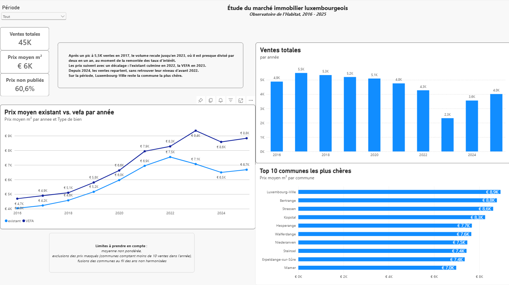
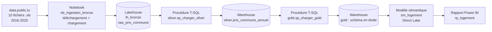
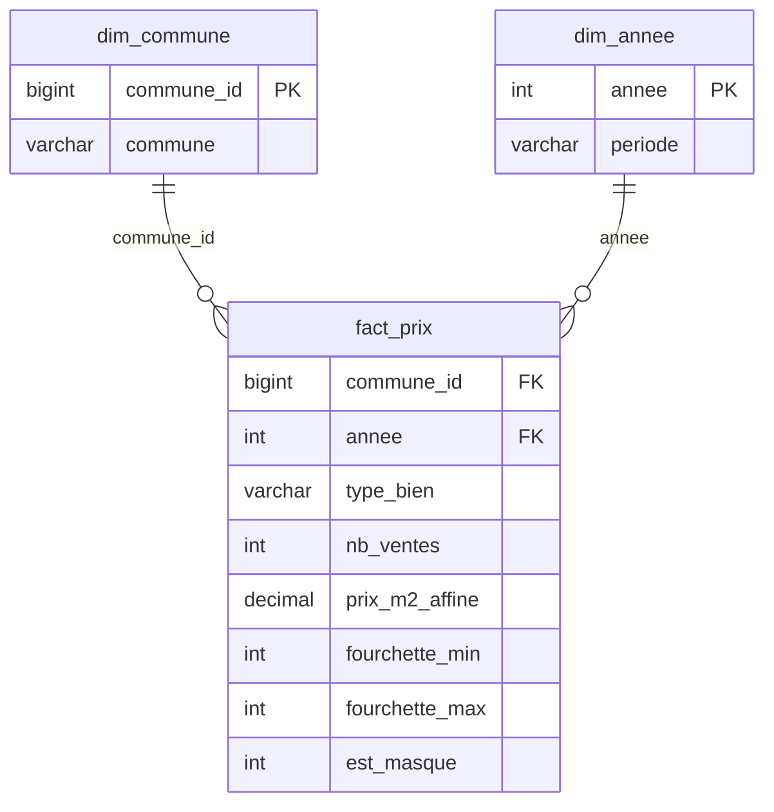

# 🏠 Marché immobilier luxembourgeois 2016-2025 — Microsoft Fabric

Projet d'analytics engineering de bout en bout dans **Microsoft Fabric** : des fichiers Excel publics de l'Observatoire de l'Habitat jusqu'à un rapport Power BI, en passant par une architecture médaillon en T-SQL et un schéma en étoile.

> **Question de départ :** comment les prix et le volume des ventes d'appartements ont-ils évolué au Luxembourg, du boom post-Covid à la remontée des taux d'intérêt ?



---

## 📊 Résultats clés

- **Le volume de ventes a presque été divisé par deux en un an** : 4 274 ventes en 2022, 2 326 en 2023, au moment de la remontée des taux d'intérêt.
- **Les prix réagissent avec un décalage** : le prix moyen au m² de l'existant culmine en 2022 (≈ 7 500 €), celui des appartements en construction (VEFA) en 2023 (≈ 9 400 €).
- **Les ventes repartent depuis 2024** (4 012 en 2025), sans retrouver leur niveau d'avant 2022.
- **Luxembourg-Ville** reste la commune la plus chère sur l'ensemble de la période.

*Les prix sont des moyennes non pondérées des communes : voir la section [Limites](#️-limites).*

---

## 🏗️ Architecture



| Couche | Élément Fabric | Contenu |
|---|---|---|
| **Bronze** | Lakehouse `lh_bronze` | Fichiers `.xls` d'origine + table brute `raw_prix_commune` (tout en texte, aucune transformation) |
| **Silver** | Warehouse `wh_logement`, schéma `silver` | Données nettoyées, typées, au format long : une ligne par commune × année × type de bien |
| **Gold** | Warehouse `wh_logement`, schéma `gold` | Schéma en étoile prêt pour l'analyse |
| **Restitution** | `sm_logement` + `rp_logement` | Modèle sémantique Direct Lake, mesures DAX et rapport |

**Correspondance avec dbt :** bronze ≈ *sources*, silver ≈ *staging*, gold ≈ *marts*.

---

## 🧱 Modèle de données (gold)



- `commune_id` est une **clé de substitution** générée avec `ROW_NUMBER()`.
- `type_bien` (existant / VEFA) est une **dimension dégénérée**, conservée dans la table de faits.
- `periode` regroupe les années : Avant Covid (2016-2019), Covid (2020), Boom post-Covid (2021-2022), Hausse des taux (2023-2025).

**Mesures DAX :** `Ventes totales`, `Prix moyen m²`, `Part prix masqués`.

---

## 🛠️ Choix techniques

| Décision | Pourquoi |
|---|---|
| **Lakehouse pour le bronze, Warehouse pour silver et gold** | Le point de terminaison SQL d'un Lakehouse est en lecture seule. Le Warehouse permet d'écrire toutes les transformations en T-SQL. |
| **Notebook pour l'ingestion** | Le Warehouse ne lit pas les anciens fichiers `.xls`. Le notebook se limite à copier le contenu brut ; tout le nettoyage est fait en SQL. |
| **Détection des données par leur contenu, jamais par leur position** | La ligne d'en-tête passe de la ligne 15 (2016) à la ligne 11 (2025). Les lignes de communes sont identifiées par `TRY_CAST(...) IS NOT NULL`, les totaux par leur libellé. |
| **`NULL` et non 0 pour les prix masqués** | `AVG()` ignore les `NULL`, alors qu'un 0 fausserait toutes les moyennes. Une colonne `est_masque` garde la trace. |
| **Passage au format long avec `UNION ALL`** | Le fichier source sépare existant et VEFA en colonnes. Une colonne constante `type_bien` transforme cette position en donnée filtrable. `UNION ALL` plutôt que `UNION`, pour ne jamais masquer un doublon de la source. |
| **Découpage robuste de la fourchette de prix** | `2458 € - 4001 €` est découpé à partir de la position du tiret (`CHARINDEX`), et non à longueur fixe, pour gérer les prix à 5 chiffres. |
| **Procédures stockées idempotentes** | Chaque procédure fait `DROP TABLE IF EXISTS` puis `CREATE TABLE ... AS SELECT` : la relancer reconstruit les tables sans créer de doublons. |
| **Contrôles de cohérence** | Nombre de lignes vérifié à chaque étape (1 020 par type de bien, 2 040 au total) et totaux vérifiés sur 2016. |

---

## 🔄 Automatisation

Un pipeline Fabric (`pl_logement`) reconstruit toute la chaîne, du téléchargement jusqu'au rapport :

1. **Notebook** `nb_ingestion_bronze` : télécharge les fichiers annuels depuis l'API de data.public.lu et les charge dans le bronze (relancer ne crée pas de doublons)
2. **Procédure** `silver.sp_charger_silver`
3. **Procédure** `gold.sp_charger_gold`
4. **Attente d'une minute** : la table de faits recréée mettait quelques secondes à être visible dans OneLake, ce qui faisait échouer l'actualisation du modèle en mode Direct Lake
5. **Actualisation** du modèle sémantique `sm_logement`

- **Planification** : le 1er de chaque mois à 06:00 (heure de Paris).
- **Contrôle de la source** : le notebook échoue si moins de 10 années sont trouvées, ce qui stoppe la chaîne avant toute modification des tables.
- **Bibliothèques** : `xlrd` est installé dans un environnement Fabric (`env_logement`), car `%pip` est désactivé dans les exécutions de pipeline.
- **Suivi** : chaque exécution est tracée dans le hub de surveillance de Fabric. L'alerte par e-mail n'est pas activée : le locataire d'essai n'a pas de boîte mail.

---

## ⚠️ Limites

- **Moyennes non pondérées** : le prix moyen fait la moyenne des communes sans tenir compte de leur nombre de ventes. Une petite commune avec quelques ventes chères peut ainsi apparaître dans le Top 10.
- **Prix masqués** : la source ne publie pas le prix des communes ayant moins de 10 ventes dans l'année ; ces prix sont exclus des moyennes.
- **Fusions de communes non harmonisées** : le pays passe de 105 communes (2016) à 102 (2018) puis 100 (2023). Les anciens et nouveaux noms coexistent (113 noms distincts).
- **Fichier glissant exclu** : la publication la plus récente couvre une période glissante (mi-2025 à mi-2026), non comparable aux années civiles. Elle n'est pas utilisée.

---

## 📁 Structure du dépôt

```
├── README.md
├── rapport.png                         # capture du rapport
│                  
└── fabric/                             # synchronisé automatiquement par l'intégration Git de Fabric
    ├── pl_logement.DataPipeline/       # pipeline planifié
    ├── env_logement.Environment/       # bibliothèques Spark (xlrd)
    ├── lh_bronze.Lakehouse/
    ├── nb_ingestion_bronze.Notebook/   # ingestion des fichiers .xls
    ├── wh_logement.Warehouse/          # tables et procédures silver / gold
    ├── sm_logement.SemanticModel/      # relations et mesures DAX
    └── rp_logement.Report/             # rapport Power BI
```

---

## ▶️ Reproduire le projet

1. Créer un espace de travail Fabric (capacité d'essai ou payante) et le relier à ce dépôt (**Paramètres de l'espace de travail → Intégration Git**, branche `main`, dossier `fabric`).
2. Définir `env_logement` comme environnement par défaut (**Paramètres de l'espace de travail → Ingénierie des données / Science → Spark settings → Environnement**), pour que le notebook dispose de `xlrd`.
3. Dans le pipeline `pl_logement`, vérifier la connexion de l'activité d'actualisation du modèle sémantique : les connexions ne suivent pas le code et sont à reconfigurer.
4. Exécuter `pl_logement` : il télécharge les fichiers, construit silver et gold, puis actualise le modèle.
5. Ouvrir le rapport `rp_logement`.

---

## 🔜 Prochaines étapes

- [x] **Automatisation** : pipeline Fabric planifié (téléchargement → notebook → procédures → actualisation du modèle). Alertes hors limite du compte d'essai.
- [ ] **Prix moyen pondéré** par le nombre de ventes (`SUMX`)
- [ ] **Harmonisation des communes fusionnées** (table de correspondance)
- [ ] **Sécurité au niveau des lignes** (RLS) et **pipeline de déploiement**

---

## 🧰 Stack

Microsoft Fabric · Lakehouse · Warehouse · T-SQL · PySpark / pandas · Power BI · DAX · Direct Lake · Git / GitHub

## 📚 Source

Ministère du Logement et de l'Aménagement du territoire — Observatoire de l'Habitat, via le portail [data.public.lu](https://data.public.lu).

---

**Marouan Dahib** — Analytics Engineer · [LinkedIn](https://www.linkedin.com/in/marouan-dahib-3546491b0/)
